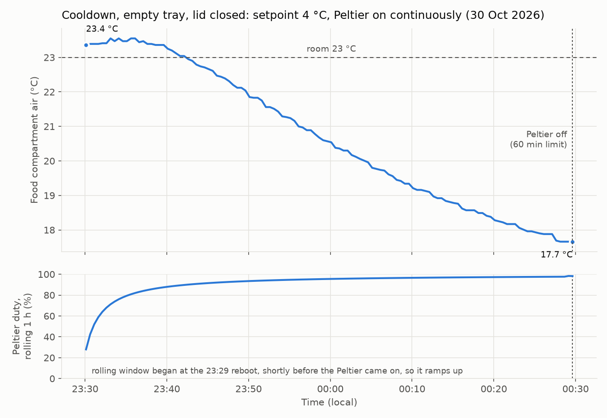
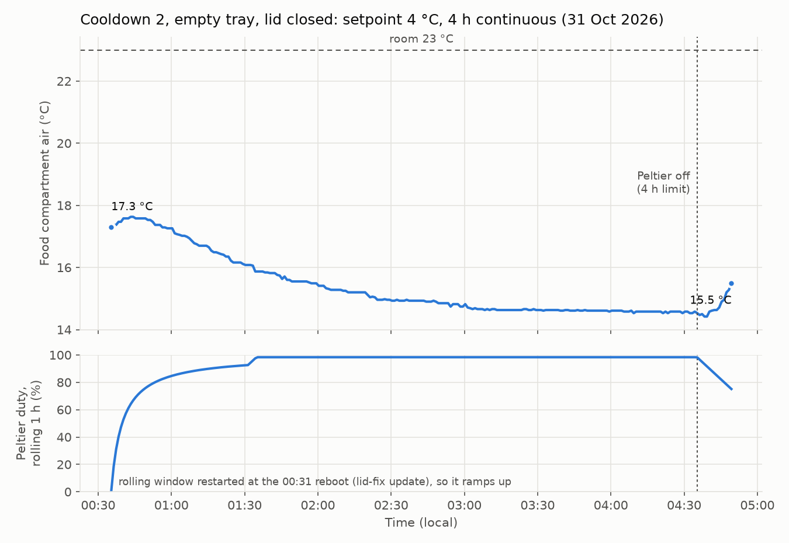
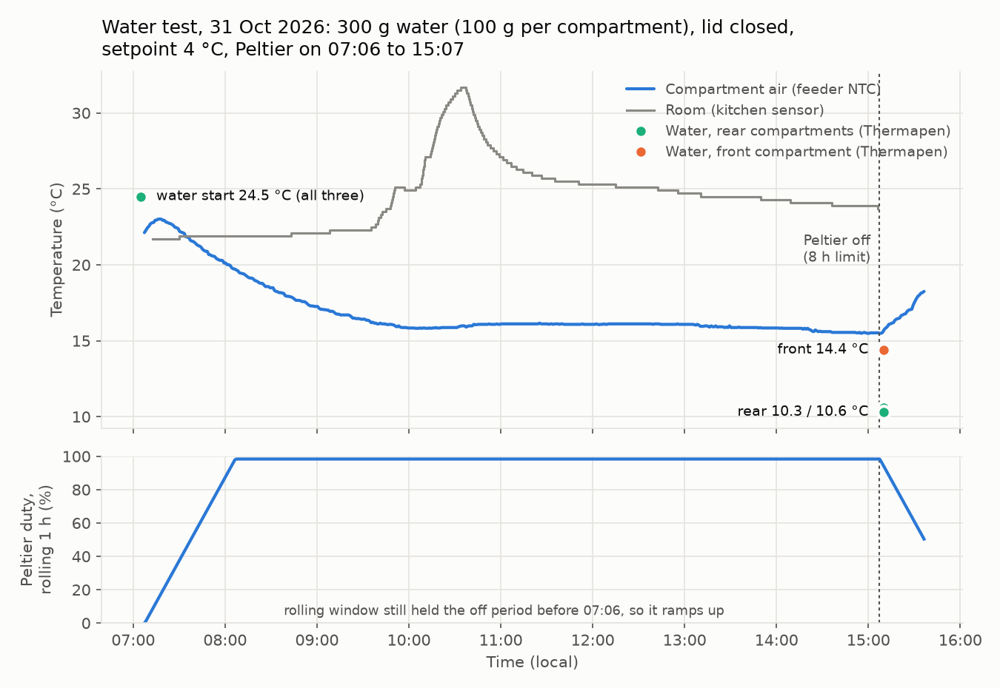

# Cooling

Hardware: Peltier (TEC) plus fan, both switched by AW9523B P1_4 (fan wired with the Peltier in hardware,
verified 2026-10-30). Food temperature: NTC on GPIO1 in the food compartment (not on the plate).
No hot-side temperature sensor exists.

## Cooldown 1 (2026-10-30 23:29 to 00:29)
Conditions: room 23 °C, empty tray, lid closed, firmware v1, setpoint 4 °C, hysteresis 0.5 °C,
max continuous on 60 min. The Peltier ran continuously until the 60 min limit switched it off.

| Time | Compartment air |
|---|---|
| 23:30 (start) | 23.4 °C |
| 00:00 | 20.5 °C |
| 00:29 (limit) | 17.7 °C |

- Rate: about 0.14 °C/min between 23:40 and 00:00, about 0.08 °C/min between 00:10 and 00:29.
  Still falling and slowing; one hour is not enough to find the floor (an exponential fit did not converge).
- User: exhaust air did not get particularly warm, so the hot side looks well inside its envelope.
- ESP temperature fell 46.9 -> 41.9 °C over the run (board, not the TEC).
- The empty compartment's air is a poor proxy for food: the next run should have a water load in a
  compartment and run several hours without the 60 min limit.

Data: `captures/20261030T2330_cooldown_4C.csv` (every 30 s). Plot: `tools/plot_cooldown.py`.

## Cooldown 2 (2026-10-31 00:35 to 04:35, overnight)
Conditions as run 1 (room about 23 °C, empty tray, lid closed, setpoint 4 °C, hysteresis 0.5 °C), but
max continuous on 240 min. Started from 17.3 °C, still cool from run 1. Peltier on for the full 4 h,
then the limit switched it off.

| Time | Compartment air |
|---|---|
| 00:35 (start) | 17.3 °C |
| 01:35 | 15.9 °C |
| 02:35 | 14.9 °C |
| 03:35 | 14.6 °C |
| 04:35 (limit) | 14.5 °C |
| 04:38 (lowest, sensor lag) | 14.4 °C |
| 04:49 (14 min after off) | 15.5 °C |

- **The empty-tray air levels off at about 14.5 °C, about 7.5 °C below the room (22 °C kitchen sensor)**, flat from about 03:00.
  The stock 12 °C setpoint and the 4 °C target are both below that floor in this configuration.
- Room temperature from Home Assistant, `sensor.kitchen_temperature_temperature` (the user's chosen
  ambient reference, `captures/20261030T2300_ambient_kitchen.csv`): 22.8 °C at 23:55 falling to 21.9 °C at
  04:00, about 22.0 °C over the plateau (03:00-04:35). **The plateau was about 7.5 °C below the room.**
  (The living-room smoke detector, hourly, read 2-3 °C warmer: `captures/20261030T2300_ambient_living_room.csv`.)
  Fetch for any window with `tools/fetch_ambient.sh`.
- Warming after switch-off: about 1 °C in 14 min.

### What limits it (hypotheses, untested)
1. The NTC reads compartment air near the lid, not the plate; the plate and anything touching it may be
   much colder. **Supported by the user (morning of 31 Oct): condensation in the cooling area, the two rear
   tray positions feel refrigerated, the front one (under the opening) does not.** Check: Thermapen in water.
2. Heat leaking in through the lid, its seal and the tray walls balances the Peltier at about 8.5 K.
3. The Peltier may be driven below its rating (supply voltage or a series element). Check: measure the
   voltage across the Peltier leads with it on.
4. The fan and heatsink may limit it, though the user found the exhaust only mildly warm.

Data: `captures/20261031T0035_cooldown_4C_4h.csv` (every 60 s).

## Water test (2026-10-31 07:06 to 15:07)
- Load: **300 g water, evenly split across the three compartments** (about 100 g each), user-loaded.
- Start water temperature: **24.5 °C average (Thermapen, user)**, just before 07:06.
- Compartment air (NTC) at start: 22.1 °C. Lid closed. Setpoint 4 °C, hysteresis 0.5 °C, cap 480 min
  (Peltier on from 07:06; cap ends about 15:06).
- Log: `captures/20261031T0706_water300g_4C.csv` (every 60 s, 8.5 h). Room: `tools/fetch_ambient.sh`.
- End readings needed: Thermapen per compartment (front and rear separately) before the lid is opened.
- Heat capacity of the load: 300 g x 4.186 J/(g K) = 1256 J/K, so 1 °C/h of water cooling = 0.35 W.

### End readings (user, Thermapen, just after the 8 h cap at 15:07, whole top cover lifted)
| Compartment (hub label) | Water | Photo |
|---|---|---|
| 1 | 10.6 °C | `img/water-test-20261031/compartment1_10.6C.jpg` |
| 2 | 10.3 °C | `img/water-test-20261031/compartment2_10.3C.jpg` |
| 3 | 14.4 °C | `img/water-test-20261031/compartment3_14.4C.jpg` |

**Compartment 3 was under the lid opening (front, uncooled), confirmed by the user.** The user also saw a fair
amount of condensation under the food tray: the cooling plate itself gets well below the air reading.

### Room (kitchen sensor, `captures/20261031T0630_ambient_kitchen.csv`)
21.8 °C at 07:00, a warm spell 10:00-11:00 peaking at 31.7 °C, then 24-25 °C, 23.7 °C at 15:06. Time-weighted
mean over the test roughly 24.5 °C. The warm spell disturbs the test: compartment air rose 15.8 -> 16.1 °C
during it.

### Compartment air (NTC)
22.1 °C at 07:07, 19.7 at 08:07, 17.0 at 09:07, 15.8 at 10:07, about 16.0 through the warm spell, 15.5 at 15:07.

### Results
- **Rear compartments (1, 2): water 24.5 -> 10.3-10.6 °C in 8 h, about 13 °C below the end room temperature.**
- **Front compartment (3): 24.5 -> 14.4 °C, about 9 °C below the room.** The rear is about 4 °C colder,
  which supports the timed cooling lid strategy (docs/feeding-strategies.md).
- **Neither reaches refrigeration (4-5 °C).** About 10.5 °C slows spoilage compared with the room but is still
  inside the 5-60 °C food danger zone.
- Heat removed from the water over 8 h: 300 g x 4.186 J/(g K) x (24.5 - 11.8 mean end) = **16.0 kJ, an average
  of 0.56 W (1.9 BTU/h)**. Per compartment: 0.20 W, 0.21 W rear; 0.15 W front.
- That is the **net** cooling delivered to the water, a lower bound. The Peltier pumps more: part of its
  capacity goes to the plate, the steel tray, the air, and to heat leaking in through the lid and walls,
  which grows as the inside gets colder. With only start and end water temperatures, the leak and the
  Peltier's gross capacity cannot be separated. A continuous water temperature log would separate them.
- The NTC air was nearly flat from 10:00, so the system was close to steady state: at about 10.5 °C rear
  water, the heat leaking in balances what the Peltier removes.

- After switch-off the compartment air rose 15.5 -> 18.3 °C in 29 min (15:07-15:36), but the user lifted the
  cover for the Thermapen readings at about 15:10, so this is not a clean leak measurement.

### Next measurements that would pin it down
1. Continuous water temperature (a logged probe in one rear compartment, e.g. a DS18B20 on a spare GPIO or
   a separate logger) to get dT/dt and the leak rate from the warm-up after switch-off.
2. Voltage across the Peltier leads while on, to check it gets full supply voltage.
3. A test with the lid opening sealed (tape) to see how much the lid leaks.
