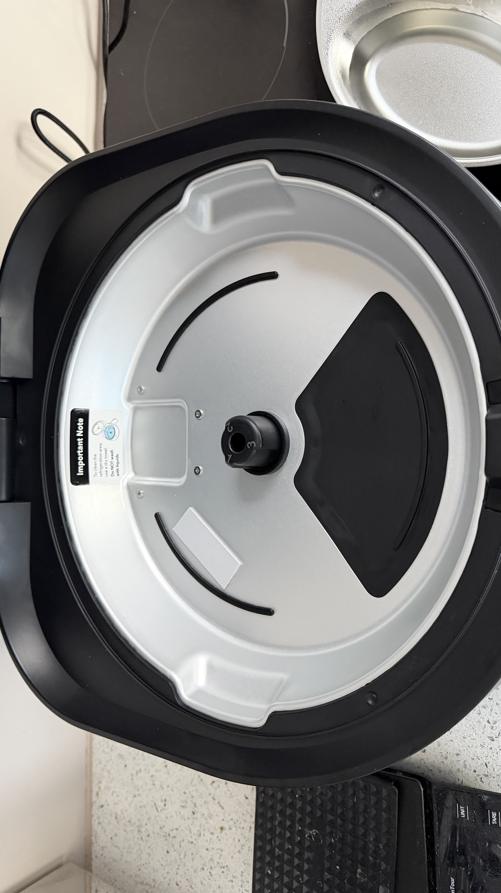

# Hardware

Board silkscreen: "PLAF109 MainBoard V1.0 2025.07.22". Facts from photos unless marked verified.

## MCU
- U1: Espressif ESP32-C3-WROOM-02U (U.FL antenna). **Verified**: ESP32-C3 QFN32 rev v0.4,
  40 MHz crystal, 4 MB flash (JEDEC 0x46/0x4016), MAC f8:5b:1b:xx:xx:xx.
- Module pinout (datasheet v1.7, `datasheets/`), top view, antenna end up:
  left 1 3V3, 2 EN, 3 IO4, 4 IO5, 5 IO6, 6 IO7, 7 IO8, 8 IO9, 9 GND;
  right (bottom to top) 10 IO10, 11 RXD/GPIO20, 12 TXD/GPIO21, 13 IO18/USB D-, 14 IO19/USB D+,
  15 IO3, 16 IO2, 17 IO1, 18 IO0; 19 centre GND pad.

## Serial / boot
- "ISP" header: GND, TX, RX, VCC; 3.3 V UART0 at 115200. **Verified** to carry the ESP32 console.
- Download mode: GPIO9 (pin 8) to GND at power-on. **Verified** (boot:0x4). Grounding pin 7 (GPIO8)
  by mistake gives boot:0x8 and a normal boot.
- SW1 does **not** reach GPIO9 (boot:0xc with SW1 held).
- Strap byte in the ROM `boot:` line: bit3 GPIO9, bit2 GPIO8, bit0 GPIO2.
- Backup battery on the blue 2-pin connector: disconnect it so a power cycle is a real cold boot.

## Other parts (unverified)
| Ref | Notes |
|---|---|
| U6 | Small QFN near centre, unidentified. Possible co-processor or driver |
| U2, U3, U7 | SOP-8, unidentified (motor driver, regulators or op-amps) |
| Cooling | Peltier, large finned heatsink, axial fan in base |

## Connectors (Chinese silkscreen)
| Ref | Label | Meaning |
|---|---|---|
| CON1 | 风扇 | Fan |
| CON7 | 电源 | Power input |
| blue 2-pin | 电池 | Backup battery |
| J4 | 电机 | Motor (tray drive) |
| CON6 | 食盆光栅 | Food-bowl optical gate (tray position) |
| CON9 | PTC | Thermistor or Peltier lead |
| CON3 | LED | Indicator LED board |
| CON2, J3, CON4, CON11, CON12 | ? | Unknown |

## Pin map (2026-10-30)
Sources: **S** static analysis (`analysis/static/`), **E** QEMU run of the stock app (`analysis/emulation/`),
**H** observed on the real board under ESPHome. Details and addresses are in the analysis READMEs.

### ESP32-C3
| GPIO | Function | Sources |
|---|---|---|
| 0 | Power source: 0 = DC/mains, 1 = battery | S, E, H (reads 0 on mains) |
| 1 | Food NTC, ADC1 ch1, 10k pull-up, B 3950 | S, E, H (22.6 C at room temp) |
| 2 | 38 kHz 50 % LEDC PWM, IR presence emitter, only during feeds | S, E |
| 3 | Lid motor current, ADC | S, E |
| 4 | Battery voltage, halved by divider | S, E, H (0 V, battery unplugged) |
| 5 | Tray motor current, ADC2 ch0; stall above 400 raw for 3 s | S, E |
| 6 | Sound chip data, one-wire, output only, idle high (WTN6-style, inferred). No BUSY input | S |
| 7 / 8 | I2C SDA / SCL, 100 kHz | S, E, H |
| 9 | AW9523B RSTN (also the download-mode strap) | S, E, H |
| 10 | Tray position gate (CON6 by elimination), pull-up, both edges | S, E |
| 18 | Button, active low; 3 s hold = Wi-Fi reset (which physical button: unknown) | S, E |
| 19 | Lid position sensor | S, E |
| 20 | IR receiver, 1 = pet present | S, E |
| 21 | UART0 TX console | H |

### AW9523B I/O expander (I2C 0x58, ID 0x23; almost certainly U6)
| Pin | Function | Sources |
|---|---|---|
| P0_0, P0_1 | HW revision straps; our board reads 0b11 = **5.2.0** | S, H (E inferred 5.2.0 from NVS log) |
| P0_4, P0_7 | Power enables (what they feed: unknown); stock holds high on DC | S |
| P0_5, P0_6 | Tray motor H-bridge: 10 fwd, 01 rev, 11 brake | S, E |
| P1_0, P1_1 | LEDs; P1_0 fault, P1_1 status blink | S, E |
| P1_4 | Peltier on/off (no PWM) | S, E (probable) |
| P1_6, P1_7 | Lid motor H-bridge: P1_7/P1_6 10 close, 01 open, 11 brake | S, E |

**Fan:** switched together with the Peltier by P1_4 in hardware (H, 2026-10-30): fan runs with P1_4 on,
with or without P0_4/P0_7; P0_4 or P0_7 alone do not run it. No firmware fan control exists (S, E).

## Cooling plate and tray coupling (2026-10-31, tray removed)

- The base under the tray is split: the **two rear thirds are an aluminium cooling plate** (silver), the
  **front third (under the lid opening) is black plastic and is not cooled**. This matches the water test:
  rear water reached 10.3-10.6 °C, the front only 14.4 °C.
- So the stock design already stores food cold at the rear and brings a compartment to the front to serve.
  That is exactly the timed cooling lid strategy (docs/feeding-strategies.md).
- **Large air gap** between the bowls and the plate: the tray hangs from a black plastic insert on the
  motor spindle (centre), so the bowls sit well above the plate. Still air across that gap is the likely
  dominant thermal resistance. Condensation forms under the tray, so the plate runs well below the ~15 °C
  the compartment-air NTC reads.
- Two arc slots and a square recess are moulded into the plate; raised lugs sit at the rim. A lowered tray
  must clear these through a full turn.
- Label on the plate: "Important Note: To clean the refrigeration area, use a dry towel. Do NOT wash with
  liquids." So the cooling area is not sealed for immersion.
- **Improvement idea (user): redesign and 3D-print the plastic spindle insert to lower the tray close to
  the plate**, cutting the air gap. Aim for ~0.5-1 mm clearance, not contact (contact adds rotation
  friction -> tray motor current toward the 400 stall threshold, and scratches the plate). Before printing,
  check where the 3 position marks live (spindle coupling vs a disc in the base): a new insert must
  reproduce them (3 marks, home ~3x wider) if they are on the coupling. See the Blu-Tack gap-measurement
  and direct-on-plate tests in docs/cooling.md.

**Tray:** 3 marks per turn; each gate edge = one compartment. Rev 5.2.0 homes at boot by the widest
mark (pulse widths about 160 ms and 510 ms seen in the NVS log, E). 6 or 12 positions need more marks on
the tray or timed stops between marks.

**Sound chip (GPIO6):** the chip itself is not identified on the board (it may be one of the SOP-8 parts U2,
U3, U7; unverified). Stock facts (S, `analysis/static/README.md`; details in `docs/esphome-firmware.md` "Sound"):
- `BSP_aduioInit` @0x4200d738 configures GPIO6 as an output only (mode 2), no pulls, level high.
- `FUN_ram_4200d7e8` sends one byte: low 5 ms, then 8 bits LSB first, "1" = high 3 ms / low 1 ms,
  "0" = high 1 ms / low 3 ms, then idle high (37 ms per byte). This is the WTN6-family one-wire format;
  the chip family is an inference.
- **No BUSY line:** no GPIO is read in connection with sound. Every `gpio_get_level` call in the app reads
  GPIO0, GPIO19, GPIO20, or the GPIO10/GPIO18 interrupt pin, and GPIO6 itself has its input disabled.
- Stock sends only two bytes, 0xEF and 0x01. No audio data path exists (no I2S, DAC or PWM audio), so any
  sound is stored inside the chip.
- Heard on hardware 2026-10-31: one bell clip (indices 0x00 and 0x01), volume 0xE0-0xEF works (0 = mute),
  0xFE stops, 0xF2 loops. Results: `docs/esphome-firmware.md` "Sound test results".
